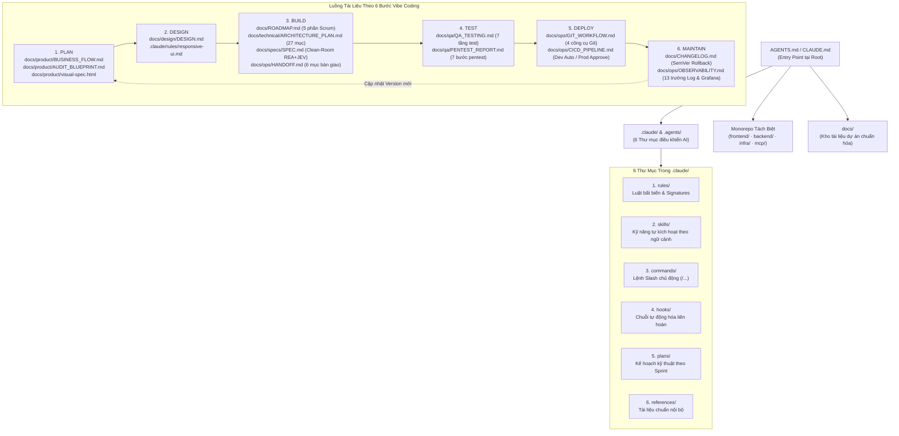

# AI-CODING-TEMPLATE — Hệ Điều Hành Tài Liệu `.md` Cho AI Agent (Vibe Coding Production Framework)

Bộ khung tổ chức dự án **AI-Native** giúp kiểm soát 100% chất lượng khi làm việc với **Claude Code, Antigravity, Cursor, Codex** từ giai đoạn lên ý tưởng đến khi vận hành thực tế (Production), dựa trên phương pháp luận **6 Bước Vibe Coding**:

$$\text{1. PLAN} \longrightarrow \text{2. DESIGN} \longrightarrow \text{3. BUILD} \longrightarrow \text{4. TEST} \longrightarrow \text{5. DEPLOY} \longrightarrow \text{6. MAINTAIN}$$

---

## 1. Triết Lý Cốt Lõi: "Cấu Trúc Trước Khi Viết Prompt"

1. **Không bắt đầu bằng Prompt dài vô tổ chức:** Khi chưa có cấu trúc thư mục và hệ thống file `.md` định hướng, AI sẽ tự chọn "đường ngắn nhất" (nhét toàn bộ logic vào 1 chỗ, tự ý đổi kiến trúc, quên 90% tính năng còn lại khi hội thoại dài).
2. **Bản đồ điều hướng trung tâm (`AGENTS.md` & `CLAUDE.md`):** Đặt ngay tại thư mục gốc (`root`). Mỗi khi mở phiên làm việc mới, AI tự động đọc file này đầu tiên để hiểu ranh giới Monorepo (`frontend/`, `backend/`, `infra/`, `mcp/`, `docs/`) và nạp bộ quy tắc trong `.claude/` (hoặc `.agents/`).
3. **Phân tách 3 cơ chế nạp ngữ cảnh để tiết kiệm 70%+ Token:**
   - **`.claude/rules/` (Always-On):** Luôn luôn kích hoạt trong mọi lượt hội thoại. Giữ ngắn gọn, chứa các luật bất biến và chữ ký tự động cập nhật (`roadmap-signature.md`, `architecture-signature.md`, `permission-gate.md`, `token-guard.md`).
   - **`.claude/skills/` (Auto-Triggered):** Tự động kích hoạt theo ngữ cảnh. AI chỉ đọc tên + 1 dòng mô tả (tốn vài chục token), khi trúng tác vụ mới mở file `SKILL.md` ra đọc sâu.
   - **`.claude/commands/` (Manual Slash Commands):** Chỉ kích hoạt khi người dùng chủ động gõ lệnh `/ten-lenh` (VD: `/build`, `/architecture-plan`, `/context-handoff`, `/clean-room`, `/audit-blueprint`). Có đặt hàng trăm file cũng không tốn token nền.

---

## 2. Sơ Đồ Kiến Trúc Hệ Thống File `.md`



---

## 3. Cấu Trúc Thư Mục Toàn Dự Án

```text
AI-CODING-TEMPLATE/
├── AGENTS.md                           # Bản đồ điều hướng trung tâm cho mọi AI Agent (Antigravity, Codex, Cursor, Claude)
├── CLAUDE.md                           # Điểm vào tương thích trực tiếp với Claude Code (/init)
├── README.md                           # Tài liệu hướng dẫn sử dụng bộ khung này
│
├── .claude/                            # 6 THƯ MỤC BẮT BUỘC ĐIỀU KHIỂN AI
│   ├── rules/                          # [Always-On] Luật bất biến luôn nạp trong mọi phiên
│   │   ├── folder-structure.md         # Quy hoạch phân khu code & cấm vứt file .md ngoài docs/
│   │   ├── roadmap-signature.md        # Bắt buộc cập nhật ROADMAP.md & CHANGELOG.md sau mỗi tính năng
│   │   ├── architecture-signature.md   # Bắt buộc cập nhật ARCHITECTURE_PLAN.md khi đổi cấu trúc/DB/API
│   │   ├── permission-gate.md          # Chặn lệnh phá hủy, bảo vệ DB Prod, tích hợp bộ phản xạ JEV
│   │   ├── token-guard.md              # Chống đọc file lan man đốt token + cơ chế Fast-Track (< 50 dòng)
│   │   └── responsive-ui.md            # Kỷ luật Mobile-First, Touch UX 44x44px, đối chiếu Visual Diff 100%
│   ├── commands/                       # [Manual Slash] Chỉ chạy khi gõ lệnh /...
│   │   ├── build.md                    # /build: Triển khai tính năng theo Sprint từ BUSINESS_FLOW.md & ROADMAP.md
│   │   ├── architecture-plan.md        # /architecture-plan: Quét hệ thống xuất hồ sơ kiến trúc 27 phần
│   │   ├── audit-blueprint.md          # /audit-blueprint: Hỏi 4 câu hỏi & mổ xẻ hệ thống mẫu
│   │   ├── context-handoff.md          # /context-handoff: Đóng gói & nhận bàn giao 6 mục giữa các Agent
│   │   ├── clean-room.md               # /clean-room: Quy trình REA -> JEV -> Opus Rebuild -> Haiku 3 Mutants
│   │   └── diagram-design.md           # /diagram-design: Sinh sơ đồ kiến trúc trực quan có luồng request
│   ├── skills/                         # [Auto-Trigger] Kỹ năng chuyên sâu nạp theo ngữ cảnh
│   │   ├── clean-room-rebuild/SKILL.md # Kỹ năng tái cấu trúc độc lập không kế thừa nợ kỹ thuật
│   │   ├── qa-7-layers/SKILL.md        # Kỹ năng kiểm thử 7 tầng (Unit -> Reliability)
│   │   ├── mcp-5-layers/SKILL.md       # Kỹ năng xây dựng MCP Server 5 lớp bảo mật
│   │   └── docker-3-skills/SKILL.md    # Kỹ năng tối ưu 90% Docker Image, Compose & Registry
│   ├── hooks/                          # [Event Hooks] Chuỗi hành động liên hoàn tự động
│   │   ├── post-feature-check.md       # Chuỗi kiểm tra tự động sau khi hoàn thành mỗi tính năng
│   │   └── animation-upgrade-chain.md  # Chuỗi 5 bước quét, đánh giá và nâng cấp animation
│   ├── plans/                          # [Technical Plans] Bản kế hoạch kỹ thuật chi tiết theo Sprint
│   │   └── sprint-01-plan.md
│   └── references/                     # [Knowledge Base] Tài liệu chuẩn nội bộ cho AI tra cứu
│       └── prompt-10-tags.md           # 10 nhãn quy ước Prompt Engineering & chuẩn đặt tên dữ liệu
│
├── .agents/                            # Đồng bộ cấu trúc Rules & Skills chuẩn Antigravity
│
├── docs/                               # KHO TÀI LIỆU TRUNG TÂM CỦA DỰ ÁN
│   ├── ROADMAP.md                      # Quản lý tiến độ 5 phần theo Scrum/Sprint (chống quên tính năng)
│   ├── CHANGELOG.md                    # Lịch sử phiên bản SemVer độc lập theo từng phân hệ để Rollback
│   ├── product/                        # 1. Phân khu Sản phẩm & Nghiệp vụ
│   │   ├── BUSINESS_FLOW.md            # Đặc tả quy trình nghiệp vụ (Mã, Tên, Actor, Luồng, Business Rules)
│   │   ├── AUDIT_BLUEPRINT.md          # Tài liệu phân tích hệ thống mẫu từ 4 câu hỏi ngữ cảnh
│   │   └── visual-spec.html            # Giao diện Kanban & Spec trực quan để duyệt bằng mắt trước khi code
│   ├── design/                         # 2. Phân khu Thiết kế UI/UX
│   │   └── DESIGN.md                   # Design System Tokens (Màu sắc, Typography, Spacing, States)
│   ├── technical/                      # 3. Phân khu Kỹ thuật & Kiến trúc
│   │   ├── ARCHITECTURE_PLAN.md        # Hồ sơ kiến trúc hệ thống 27 phần (kèm mục NOT_FOUND Audit)
│   │   └── FEATURE_MCP.md              # Đặc tả phân quyền Read/Write Scopes cho MCP Server 5 lớp
│   ├── specs/                          # 4. Phân khu Đặc tả Clean-Room
│   │   └── SPEC.md                     # Đặc tả hành vi kèm bằng chứng REA & kiểm thử đột biến (Mutants)
│   ├── qa/                             # 5. Phân khu Kiểm thử & Bảo mật
│   │   ├── QA_TESTING.md               # Ma trận 7 tầng kiểm thử của QA Testing Engineer Agent
│   │   └── PENTEST_REPORT.md           # Hồ sơ 7 bước Pentest & rà soát lỗ hổng thư viện bên thứ 3
│   └── ops/                            # 6. Phân khu Vận hành, Git, CI/CD & Chuyển giao
│       ├── HANDOFF.md                  # Bản bàn giao ngữ cảnh 6 mục giữa Agent 1 -> Agent 2
│       ├── GIT_WORKFLOW.md             # Quy trình phối hợp 4 công cụ Git an toàn Token
│       ├── CICD_PIPELINE.md            # Quy trình 8 bước CI/CD & 3 chiến lược Zero-Downtime
│       └── OBSERVABILITY.md            # Chuẩn 13 trường bản ghi Log & Giám sát Grafana/Loki/Tempo
│
├── frontend/                           # Tầng Giao diện (Tách 3 phân khu: landing-page/, user/, admin/)
├── backend/                            # Tầng Xử lý API & Business Logic
├── infra/                              # Tầng Hạ tầng, Database, Cache, Storage & Monitoring
└── mcp/                                # Tầng MCP Server & Gateway độc lập
```

---

## 4. Hướng Dẫn Bắt Đầu Nhanh (Quick Start)

1. **Bước 1 (Plan):** Ghi các gạch đầu dòng ý tưởng vào `docs/product/BUSINESS_FLOW.md` (hoặc dùng `/audit-blueprint` nếu muốn học hỏi từ một hệ thống lớn có sẵn). Mở `docs/product/visual-spec.html` trên trình duyệt để rà soát bảng tính năng trực quan.
2. **Bước 2 (Design):** Định nghĩa màu sắc, font chữ, bố cục trong `docs/design/DESIGN.md`.
3. **Bước 3 (Build):** Chia các tính năng vào `docs/ROADMAP.md` theo từng Sprint (~10 tính năng/đợt). Gõ `/build` để AI thực thi từng Sprint và tự động cập nhật `ROADMAP.md` + `ARCHITECTURE_PLAN.md`.
4. **Bước 4 (Chuyển giao phiên / Refactor):**
   - Khi hội thoại dài cần mở phiên Agent mới: Gõ `/context-handoff giao` để xuất `docs/ops/HANDOFF.md`, sau đó ở phiên mới gõ `/context-handoff nhận @docs/ops/HANDOFF.md`.
   - Khi muốn viết lại tính năng cũ sạch nợ kỹ thuật: Gõ `/clean-room` để chạy quy trình REA $\rightarrow$ JEV $\rightarrow$ Opus $\rightarrow$ Haiku.
5. **Bước 5 (Test & Deploy):** Mở một phiên Agent đóng vai `QA Testing Engineer` chạy đủ 7 tầng kiểm thử trong `docs/qa/QA_TESTING.md`, đẩy nhánh qua SSH + `gh pr create`, và duyệt PR trên GitHub để kích hoạt CI/CD lên Production.
