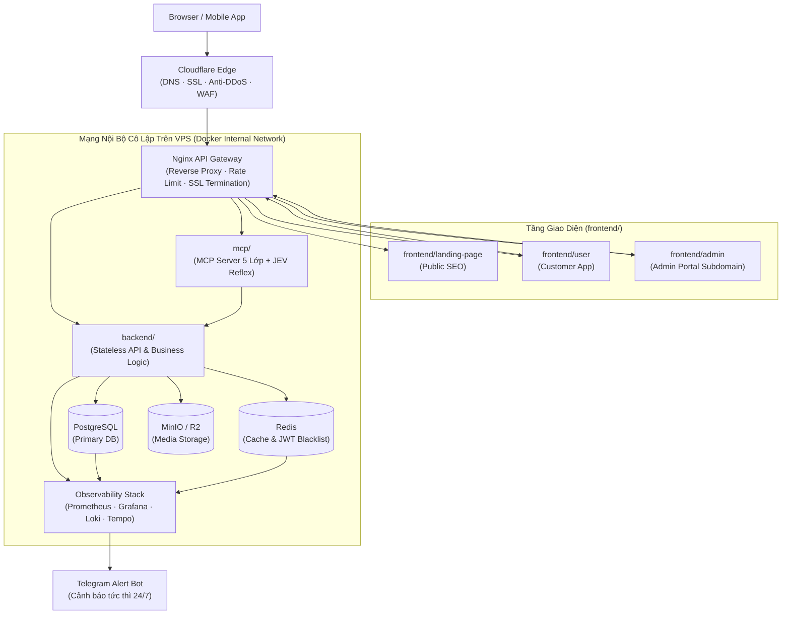
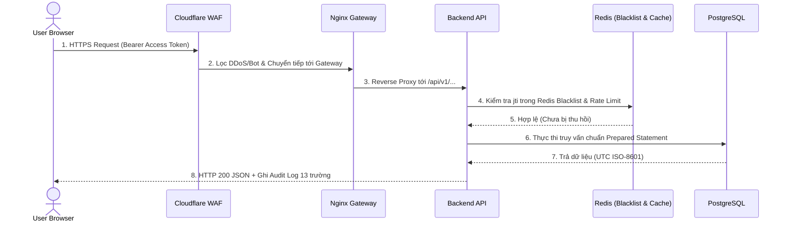
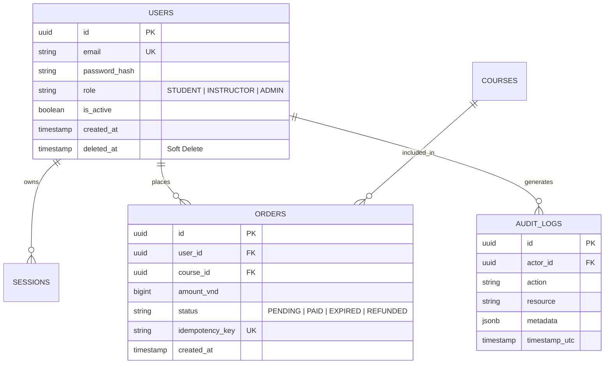

# SYSTEM ARCHITECTURE PLAN — Hồ Sơ Kiến Trúc Hệ Thống 27 Phần (`ARCHITECTURE_PLAN.md`)

> **Quy tắc tự động đồng bộ (`.claude/rules/architecture-signature.md`):**
> - Tệp này được tạo mới hoặc làm mới toàn diện thông qua lệnh `/architecture-plan`, và được AI tự động cập nhật ngầm mỗi khi có thay đổi về thư mục, Database, API hoặc hạ tầng.
> - Mọi thành phần còn khuyết trong thực tế được liệt kê thẳng thắn tại **Mục 27 (`[NOT_FOUND]` Audit)** để người làm chủ dự án kiểm soát 100%.

---

## 1. Tổng Quan Dự Án & Mục Tiêu Kinh Doanh (Project Overview)
- **Tên hệ thống:** Nền tảng SaaS / LMS / Thương mại điện tử chuẩn AI-Native.
- **Mục tiêu cốt lõi:** Đảm bảo khả năng mở rộng (Scalable), bảo mật đa tầng, chi phí hạ tầng tối ưu và không bao giờ mất kiểm soát khi phát triển bằng AI Agent.

## 2. Bảng Tổng Hợp Tech Stack Thực Tế (Technology Stack)

| Tầng (Layer) | Công nghệ chuẩn | Vai trò chính |
| :--- | :--- | :--- |
| **Frontend (`frontend/`)** | Next.js / React + TypeScript + Tailwind CSS | Tách biệt 3 phân khu: `landing-page` (SEO), `user` (Web App), `admin` (Portal). |
| **Backend (`backend/`)** | Node.js (NestJS / FastAPI / Go) Stateless | Xử lý REST/RPC API, Business Rules, RBAC, Webhook IPN. |
| **Database & Cache (`infra/`)** | PostgreSQL 16 + Redis 7 | Lưu trữ quan hệ chuẩn ACID + Bộ nhớ đệm & JWT Blacklist. |
| **Object Storage (`infra/`)** | MinIO (Self-hosted) / Cloudflare R2 | Lưu trữ ảnh, tài liệu PDF, video (tối ưu 90% chi phí băng thông). |
| **AI & MCP (`mcp/`)** | Model Context Protocol + JEV Middleware | Kết nối Claude/ChatGPT an toàn qua 5 lớp bảo mật. |
| **Observability (`infra/`)** | Prometheus + Grafana + Loki + Tempo | Giám sát chỉ số, tập trung Log 13 trường và bắn cảnh báo Telegram. |

## 3. Cấu Trúc Thư Mục Monorepo (Folder Structure & Boundaries)
```text
project-root/
├── AGENTS.md & CLAUDE.md       # Bản đồ điều hướng trung tâm
├── .claude/ & .agents/         # 6 thư mục điều khiển AI (rules, commands, skills, hooks, plans, references)
├── docs/                       # Kho tài liệu dự án 6 phân khu (product, design, technical, specs, qa, ops)
├── frontend/                   # Giao diện người dùng (landing-page/, user/, admin/)
├── backend/                    # Xử lý API & Business Logic
├── infra/                      # Docker Compose, Nginx Gateway, DB Migrations, Monitoring
└── mcp/                        # MCP Server & Gateway độc lập
```

## 4. Sơ Đồ Kiến Trúc Hệ Thống Tổng Thể (System Architecture Diagram)



## 5. Cách Ly Mạng Nội Bộ & Hạ Tầng VPS (Internal Network Isolation)
- Chỉ duy nhất **Nginx API Gateway** mở cổng `80`/`443` ra ngoài.
- Các dịch vụ `postgres` (`5432`), `redis` (`6379`), `minio` (`9000`), `backend` (`4000`) chỉ giao tiếp trong mạng nội bộ Docker (`internal_net`), ngăn chặn hoàn toàn việc quét cổng trực tiếp từ Internet.

## 6. Hành Trình Chi Tiết Của Một Request (Request Journey Step-by-Step)


## 7. Thiết Kế Cơ Sở Dữ Liệu & Sơ Đồ Thực Thể (Database ERD)


## 8. Chiến Lược Đánh Chỉ Mục Database (6 Kiểu Indexing Tối Ưu Từ 5s Xuống ms)
1. **B-Tree Index:** Cho các cột tìm kiếm chính xác và sắp xếp (`email`, `created_at`).
2. **Composite Index (Chỉ mục kết hợp):** `(user_id, status, created_at DESC)` cho truy vấn lịch sử đơn hàng.
3. **Partial Index (Chỉ mục có điều kiện):** `WHERE deleted_at IS NULL` để tăng tốc truy vấn bản ghi đang hoạt động.
4. **Unique Index:** Đảm bảo tính duy nhất cho `idempotency_key` và `email`.
5. **GIN Index:** Cho các cột `JSONB` hoặc tìm kiếm văn bản (Full-text search).
6. **Covering Index (`INCLUDE`):** Giúp trả kết quả ngay từ Index (`Index-Only Scan`) mà không cần đọc lại Heap.

## 9. Chiến Lược Bộ Nhớ Đệm & Thu Hồi Cache (Redis Caching Strategy)
- Áp dụng mô hình **Cache-Aside** kết hợp xóa chủ động (**Explicit Invalidation**) ngay khi có thao tác cập nhật dữ liệu gốc.
- Phân vùng rõ tiền tố khóa: `cache:course:*`, `auth:blacklist:*`, `ratelimit:ip:*`.

## 10. Lưu Trữ File & Media (MinIO Self-Hosted vs Cloud R2/S3)
- Tải lên trực tiếp qua **Presigned URL** có thời hạn 5 phút.
- Đổi toàn bộ tên tệp sang `UUIDv7` để triệt tiêu hoàn toàn lỗ hổng Path Traversal.

## 11. Kiến Trúc Xác Thực (`JWT + Refresh Token + Redis Blacklist`)
- `access_token` ngắn hạn (`15 phút`), `refresh_token` dài hạn (`7 ngày`) có cơ chế xoay vòng (**Refresh Token Rotation**).
- Thu hồi tức thì qua `Redis Blacklist` khi người dùng đăng xuất hoặc bị khóa tài khoản.

## 12. Ma Trận Phân Quyền (`RBAC / ABAC Matrix`)
- Kiểm soát quyền ở cả cấp Route Guard và cấp Dữ liệu (người dùng nào chỉ được đọc/sửa đúng tài nguyên thuộc sở hữu của người đó - chống IDOR).

## 13. Năm Lớp Bảo Mật Ứng Dụng & Chống Lỗ Hổng OWASP
1. Cloudflare WAF & Rate Limiting.
2. Chuẩn hóa đường dẫn (`path.resolve` + whitelist thư mục) chống **Path Traversal**.
3. Truy vấn tham số hóa 100% chống **SQL Injection**.
4. Lọc đầu ra & Content Security Policy (CSP) chống **XSS**.
5. Danh sách trắng tên miền ngoại vi chống **SSRF & RCE**.

## 14. Kiến Trúc MCP Server & MCP Gateway (`mcp/`)
- Tách riêng thành dịch vụ độc lập với **5 lớp bảo mật**: API Key có hạn dùng $\rightarrow$ Session Rate Limit $\rightarrow$ RBAC Scope $\rightarrow$ Tool Registry $\rightarrow$ Scoped API Client.

## 15. Bộ Phản Xạ Chấm Điểm Rủi Ro JEV (`JEV Reflex Middleware`)
- Đánh giá mọi hành động nhạy cảm của AI Agent theo 3 dạng: **Boolean** (`True/False`), **Choice** (Phân luồng phòng ban), và **Score** (`0.00–0.30`: Allow, `0.31–0.70`: Ask User, `0.71–1.00`: Block).

## 16. Kiến Trúc AI Gateway, RAG & Hệ Thống Benchmark Evals
- Kiểm soát đa mô hình qua AI Gateway (Routing, Fallback, Prompt Caching).
- Hệ thống RAG trả lời kèm trích dẫn nguồn và bộ Benchmark Evals tự động phát hiện ảo giác (Hallucination).

## 17. Chuẩn Hóa 13 Thành Phần Bản Ghi Log (`Structured Logging`)
- Mọi bản ghi log xuất ra định dạng JSON gồm đủ 13 trường chuẩn (chi tiết tại [`docs/ops/OBSERVABILITY.md`](../ops/OBSERVABILITY.md)).

## 18. Hệ Thống Giám Sát & Cảnh Báo (`Prometheus + Grafana + Loki + Tempo`)
- Theo dõi thời gian thực CPU, RAM, Disk, HTTP 5xx, độ trễ API và đẩy cảnh báo khẩn cấp về Telegram.

## 19. Xử Lý Lỗi Tập Trung & Tự Phục Hồi (`Error Handling & Circuit Breaker`)
- Cấm tuyệt đối `catch (e) {}` rỗng (Zero Silent Catch). Tự động ngắt mạch (Circuit Breaker) khi dịch vụ bên thứ ba bị treo.

## 20. Đồng Bộ Dữ Liệu & Sao Lưu (`CDC Pipeline & Backup`)
- Thiết lập Change Data Capture (CDC) đồng bộ dữ liệu sang kho dự phòng; bật đồng thời **RDB Snapshot + AOF** cho Redis.

## 21. Chiến Lược Kiểm Thử 7 Tầng (`7-Layer QA Testing`)
- Bao phủ: Source/Unit $\rightarrow$ Integration $\rightarrow$ Business Flow $\rightarrow$ E2E Playwright $\rightarrow$ Performance $\rightarrow$ Security/Pentest $\rightarrow$ Reliability/Recovery.

## 22. Quy Trình Git 4 Công Cụ (`Git CLI + SSH Key + GitHub CLI + MCP`)
- Tách nhánh theo tính năng, đẩy code qua SSH Key và tạo PR nhẹ nhàng bằng `gh` CLI (chi tiết tại [`docs/ops/GIT_WORKFLOW.md`](../ops/GIT_WORKFLOW.md)).

## 23. Quy Trình CI/CD 8 Bước (`Dev Auto / Prod Manual Approval`)
- AI chỉ được tự động triển khai lên môi trường `Dev/Staging`. Môi trường `Production` bắt buộc con người bấm **Approve PR** trên GitHub.

## 24. Tối Ưu Hóa Docker (`Multi-Stage Build`)
- Cắt giảm 90% dung lượng Image (từ `~1.2GB` xuống `~120MB`), chạy bằng user non-root.

## 25. Chiến Lược Zero-Downtime Deployment (`Rolling / Blue-Green / Canary`)
- Nâng cấp phiên bản mới không rớt bất kỳ kết nối nào của người dùng đang thanh toán hoặc học trực tuyến.

## 26. Tối Ưu Chi Phí Hạ Tầng & AI (`Cost Optimization`)
- Tận dụng Prompt Caching, Model Routing (Haiku cho tác vụ nhẹ, Opus/Sonnet cho kiến trúc) và Batch API để giảm tới 90% chi phí API AI.

## 27. Báo Cáo Điểm Khuyết Hệ Thống (`[NOT_FOUND]` Audit & Action Plan)
> *Khi chạy `/architecture-plan` trên dự án thực tế, AI tự động liệt kê các mục chưa hoàn thiện tại đây:*
- `[NOT_FOUND - Cần triển khai ở Sprint 02]`: Tích hợp thực tế cổng Webhook IPN tại `backend/src/modules/payment/`.
- `[NOT_FOUND - Cần triển khai ở Sprint 03]`: Khởi tạo dịch vụ MCP Server thực thi trong `mcp/src/`.
- `[NOT_FOUND - Cần triển khai ở Sprint 04]`: Tệp workflow `.github/workflows/ci-cd.yml` cho pipeline 8 bước.
